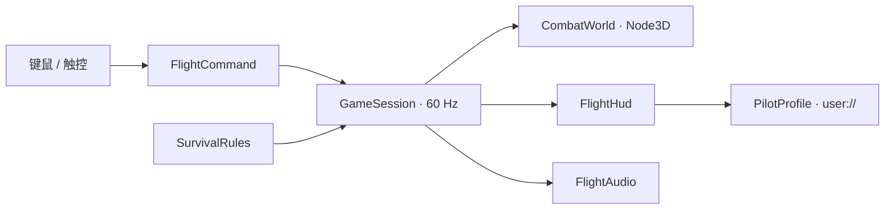

Airwar Together：Godot 2.5D 升级设计
==================================

背景与目标
----------
参考版本是 Java Swing/AWT 飞机生存游戏：鼠标移动、激光预警、追踪激光、红点弹幕、生命和金币道具、四档难度、飞机解锁与本地账号。没有玩家射击或网络多人。新版本采用 Godot 4.7.2 .NET，真实 3D 场景承载平面生存玩法，面向 PC 与 Android。美术方向由用户确定为科幻空战。

首版交付单人生存循环、键鼠与触控、机库、暂停、结算和本地进度。0.2 版本进一步加入独立 3D 自由空战与真实 ENet 房间：最多 32 人，四个 20 公里战区，服务端判定飞行、武器、伤害与跃迁。当前玩法及验证边界见 [星际空战说明](orbital-frontier.md)。以下保留 2.5D 模式的设计约束。

实现约束
--------
- C# 战斗状态与 Node3D 表现解耦；固定 60 Hz 更新，使用三维位置、速度和空间碰撞。当前运动规则将飞行限制在 XZ 平面，改为自由飞行时替换运动规则与输入映射。
- 原创网格、材质、特效与合成音频已固化为可编辑资产。主场景实例化战场、UI、音频与战机子场景；运行时代码负责玩法与动画，不再逐个构建几何、布局和音频采样。原作资源作为视觉与玩法参考。Noto CJK 字体依照随附许可证使用。
- PC 与 Android 使用同一个项目。选择 Compatibility 渲染器覆盖更多安卓设备，发光视觉由自发光材质、外层透明光晕和粒子实现，不依赖屏幕空间 bloom。
- Android 固定横屏，支持相对拖动、多点触控与安全区；窗口变化时重新布局和调整相机取景。PC 支持 WASD、方向键、鼠标，以及键盘菜单操作。
- 保留五点生命、地狱一命、受伤后两秒保护、四档难度、生命和金币拾取。ESC 暂停；应用失焦暂停。

玩家流程
--------
启动加载本地飞行员档案 → 主菜单选择难度或进入机库 → 开始生存 → 躲避预警后的激光与移动弹幕、收集补给、使用冲刺与清弹脉冲 → 死亡结算保存成绩与金币 → 重试或返回机库。

所有机体采用真实三维网格，12 款机体通过造型和涂装区分；解锁只改变外观。设置保存音乐、音效、画质与触控灵敏度。

组件边界
--------
| 组件 | 职责 |
| --- | --- |
| Core / GameSession | 固定步进、生命、技能、碰撞、拾取、评分与事件，拥有唯一权威状态 |
| Core / SurvivalRules | 难度、生成节奏、激光预警与威胁生命周期 |
| Input / PilotInput | 将键鼠或触控转换成 FlightCommand，菜单不会驱动飞机 |
| Presentation / CombatWorld | 相机、战机网格、战场、危险物和粒子的三维表现 |
| UI / FlightHud | 主菜单、机库、HUD、暂停、结算与设置 |
| Persistence / PilotProfile | 本地金币、解锁、最高分与偏好；临时文件和备份保证存档恢复 |
| Audio / FlightAudio | 播放已保存的音乐和事件音效资源，遵守保存的音量设置 |

联机扩展
--------
3D 客户端发送带序号的飞行命令，独立的 ArenaSimulation 推进状态；ArenaNetwork 发送带 tick 与实体 ID 的快照。伤害、击杀和跨区跃迁由服务端确认。表现层插值姿态并进行短时位置外推；当前没有完整的本地输入回放预测。单人暂停规则没有直接复用到多人局，打开菜单期间服务器继续运行。

3D 模式已使用独立的六向姿态、追尾/驾驶舱相机、机炮与房间入口；立体弹道使用扫掠碰撞和地形/建筑遮挡。房间通过 IP 与 UDP 端口直连；中心匹配和 NAT 穿透尚未实现。

持久化与异常
------------
档案保存在 `user://pilot_profile.json`，版本号为 1；解析失败先恢复备份，仍失败则建立初始档案并提示。没有使用旧 CSV 密码模拟在线身份。首次启动即能玩，飞行员代号可以编辑。购买、选择机体、设置变化和结算都立即保存。

验证与验收
----------
- C# 构建无错误，Godot 能加载主场景并连续运行。
- 固定步长验证跨越激光的碰撞、无敌时间、拾取只结算一次、技能冷却、四档难度与边界约束。
- 实际界面验证主菜单、机库、游戏、暂停和结算；在桌面窗口和安卓比例下检查布局。
- 实际 PC 与 Android 导出，记录工具链与产物；安卓性能、触摸手感和刘海安全区需要真机验证，不以模拟截图替代。
- 原参考项目保留，现有 Godot 初始化工程直接升级，不将原 Java 编译产物纳入新游戏。
